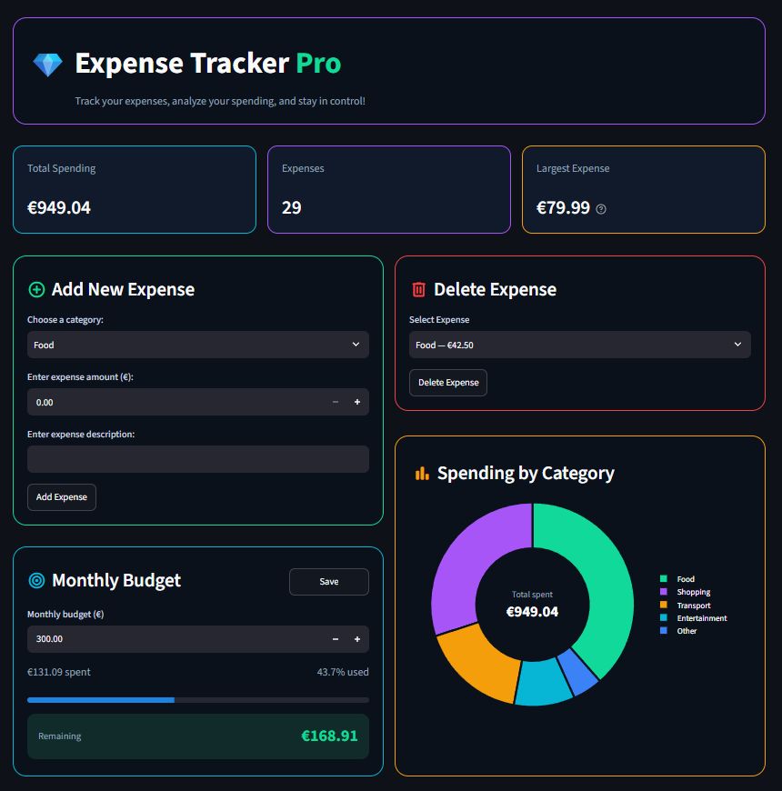
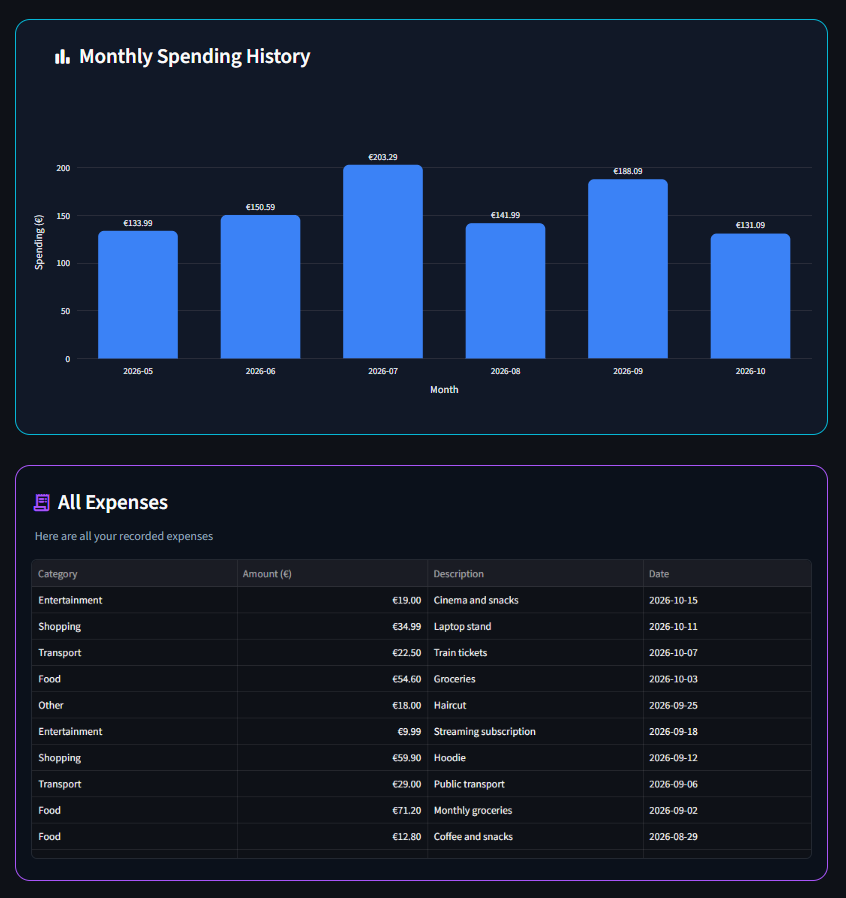

# 💰 Expense Tracker Pro

A personal expense tracking project built with **Python, Streamlit, and Plotly**, now available in two versions.

Expense Tracker Pro helps users record expenses, visualize spending habits, manage a monthly budget, and explore their spending history through an interactive dashboard.

## 🌐 Live Applications

| Version | Try it | Source code |
| --- | --- | --- |
| **V1 — JSON / temporary-data demo** | [Launch V1](https://expense-tracker-pro-2026.streamlit.app/) | [`main` branch](https://github.com/AhmadBiko/expense-tracker-pro/tree/main) |
| **V2 — Google login + PostgreSQL** | [Launch V2](https://expense-tracker-pro-v2.streamlit.app/) | [`feature/postgresql` branch](https://github.com/AhmadBiko/expense-tracker-pro/tree/feature/postgresql) |

> This `main` branch contains **V1**. The multi-user **V2** application, including `db_app.py` and `database.py`, lives on the `feature/postgresql` branch.

### What's new in V2?

- Google OAuth sign-in and sign-out
- Persistent Neon PostgreSQL storage via Psycopg 3
- User-specific expenses and monthly budgets
- Interactive spending charts and cloud deployment

[Read the full V2 documentation](https://github.com/AhmadBiko/expense-tracker-pro/blob/feature/postgresql/README.md)

**🌐 [Try the V1 Live Demo](https://expense-tracker-pro-2026.streamlit.app/)**

The public demo runs with temporary, session-specific data. Expenses and budgets are not permanently stored; use the local application for JSON persistence.

The project started as a Python command-line application and has evolved into a web-based dashboard. It was developed as a hands-on learning project to practice Python programming, data handling, testing, and web application development.

## 📸 Dashboard Preview

### Main Dashboard


### Monthly Spending History


## ✨ Features

### Interactive Dashboard
- Dark-themed Streamlit interface
- Total spending and expense summary metrics
- Spending breakdown by category using a donut chart
- Monthly spending history using an interactive bar chart
- Expense table with newest transactions displayed first

### Expense Management
- Add expenses with a category, amount, and description
- Automatically record the expense date
- Delete existing expenses
- Validate user input
- Save and load expenses locally using JSON (`app.py`)
- Try a separate public demo with temporary session-specific data (`demo_app.py`)

### Monthly Budget
- Set and save a monthly spending budget
- Track spending for the current month
- Visualize budget usage with a progress indicator
- Compare monthly spending against the selected budget

### Data Analysis
- Calculate total spending
- Calculate spending by category
- Identify the most expensive expense
- Group expenses by month
- Handle older expense records without dates

## 🛠️ Tech Stack

| Technology | Purpose |
|---|---|
| Python | Application logic and data processing |
| Streamlit | Interactive web dashboard |
| Plotly | Spending charts and visualizations |
| JSON | Local data persistence in the original application |
| Streamlit Session State | Temporary, per-session data in the public demo |
| unittest | Automated testing |
| Git & GitHub | Version control |

## 🚀 Getting Started

### 1. Clone the Repository

```bash
git clone https://github.com/AhmadBiko/expense-tracker-pro.git
cd expense-tracker-pro
```

### 2. Create a Virtual Environment

```bash
python -m venv .venv
```

Activate it on Windows PowerShell:

```powershell
.\.venv\Scripts\Activate.ps1
```

Or on macOS/Linux:

```bash
source .venv/bin/activate
```

### 3. Install Dependencies

```bash
python -m pip install -r requirements.txt
```

### 4. Run the Web Application

```bash
streamlit run app.py
```

Streamlit will display a local URL, typically:

`http://localhost:8501`

To run the public-demo version locally instead:

```bash
streamlit run demo_app.py
```

### 5. Run the Command-Line Version (Optional)

```bash
python main.py
```

## 🧪 Automated Testing

The project includes **21 automated unit tests** covering expense calculations, validation, data manipulation, and persistence-related functionality.

Run all tests with:

```bash
python -m unittest -v
```

Latest local test result:

**21 tests passed.**

## 📁 Project Structure

```text
expense-tracker-pro/
├── app.py
├── demo_app.py
├── main.py
├── expense_functions.py
├── test_expense_tracker.py
├── requirements.txt
├── screenshots/
│   ├── dashboard.png
│   └── spending-history.png
├── .gitignore
└── README.md
```

- `app.py` — Original Streamlit dashboard with local JSON persistence
- `demo_app.py` — Public Streamlit demo with session-based temporary storage
- `main.py` — Command-line interface
- `expense_functions.py` — Core expense and budget functions
- `test_expense_tracker.py` — Automated unit tests

The original application stores expense and budget data in local JSON files. These files are excluded from Git tracking to avoid accidentally publishing personal financial information. The public demo does not save expenses or budgets to those files; data is temporary and tied to a visitor's Streamlit session.

## 🗺️ Development Roadmap

- [x] Build a command-line expense tracker
- [x] Implement JSON data persistence
- [x] Add input validation and error handling
- [x] Implement automated unit tests
- [x] Build a Streamlit dashboard
- [x] Create spending charts with Plotly
- [x] Add monthly budget tracking
- [x] Add monthly spending history
- [x] Add dates and chronological expense sorting
- [x] Add dashboard screenshots
- [x] Test installation in a clean environment
- [ ] Explore SQLite database integration
- [x] Deploy a public session-based web demo
- [x] Add persistent, private multi-user storage and authentication (available on the `feature/postgresql` branch)

## 📌 Project Status

**V1 — released on `main`. V2 — deployed separately on `feature/postgresql`.**

The original application passed all 21 automated tests, and its dependencies and dashboard were verified in a fresh virtual environment. The public demo is available online with temporary session-specific storage.

[Open live demo](https://expense-tracker-pro-2026.streamlit.app/)

[View releases](https://github.com/AhmadBiko/expense-tracker-pro/releases)

## 👨‍💻 Author

**Ahmad Biko**

Computer Engineering Student — HTW Berlin

[GitHub Profile](https://github.com/AhmadBiko)

---

*Built as a practical Python development and software engineering learning project.*
